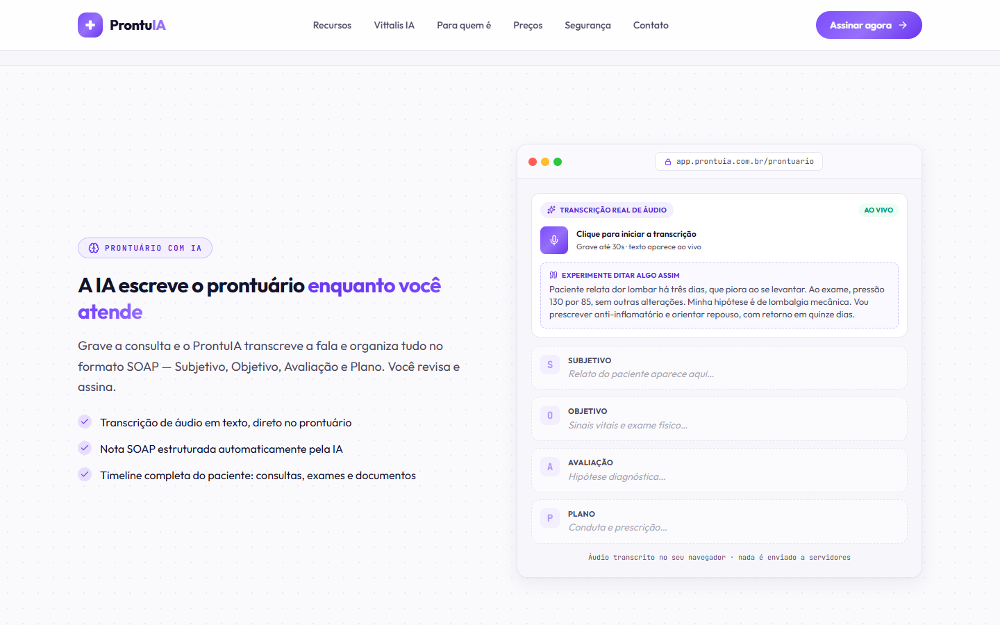
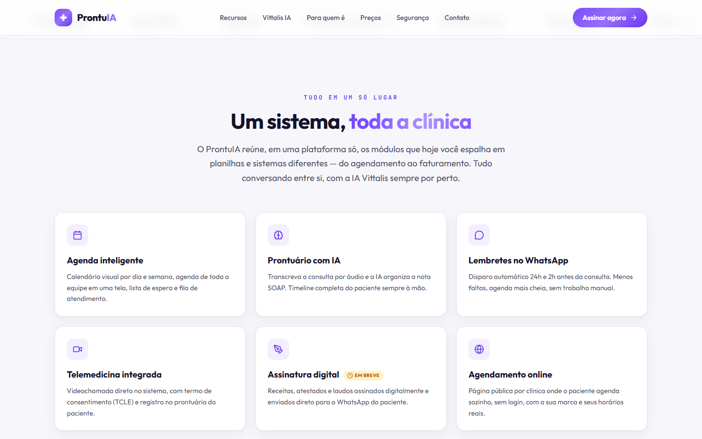

# Guilherme Mazzo

**Desenvolvedor full-stack · Fundador da Vittalix**

Crio produtos SaaS completos, da arquitetura de dados à experiência de quem usa. Meu principal projeto é o **ProntuIA**, uma plataforma de gestão clínica que reúne prontuário eletrônico, teleconsulta e recursos de inteligência artificial.

[Conheça o ProntuIA](https://prontuia.com.br) · [Portfólio](https://mazzo.vittalix.com.br) · [LinkedIn](https://www.linkedin.com/in/guilhermemazzoo/)

## ProntuIA · projeto principal

O ProntuIA foi pensado para ajudar clínicas e profissionais de saúde a acompanhar a jornada do paciente em um só lugar, do agendamento ao atendimento e aos documentos clínicos.

**O que construo nesse produto:**

- Fluxos de prontuário eletrônico e teleconsulta.
- Recursos de IA para apoiar o trabalho clínico.
- Experiência web responsiva para o dia a dia de profissionais de saúde.

**Stack:** `React` · `TypeScript` · `Supabase` · `Tailwind CSS`

→ [Acessar o ProntuIA](https://prontuia.com.br)

## Outros projetos

| Projeto | O que é | Links |
| --- | --- | --- |
| **Portfólio** | Projetos, experiência e processo de trabalho. | [Código](https://github.com/vittalixcommandcenter-coder/portifoliomazzo) · [Site](https://mazzo.vittalix.com.br) |

## Tecnologias que uso

`React` · `Next.js` · `TypeScript` · `Node.js` · `Supabase` · `PostgreSQL` · `Tailwind CSS` · `Cloudflare` · `WebRTC`

## Vamos conversar?

Se você tem um produto para tirar do papel ou quer trocar ideias sobre software, [entre em contato](mailto:guilhermazzo@gmail.com).
